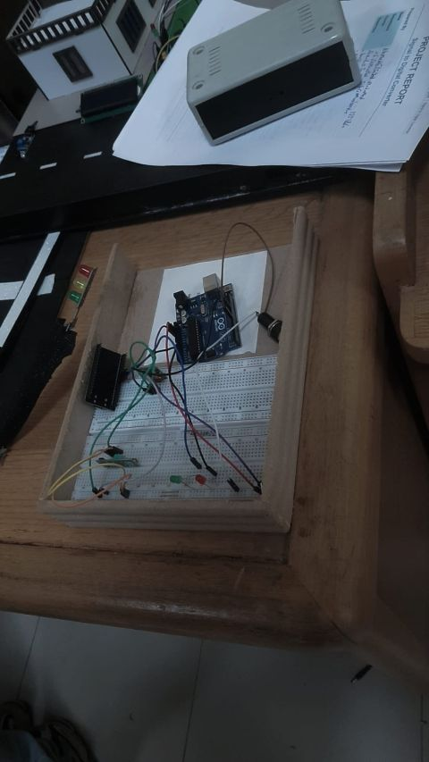
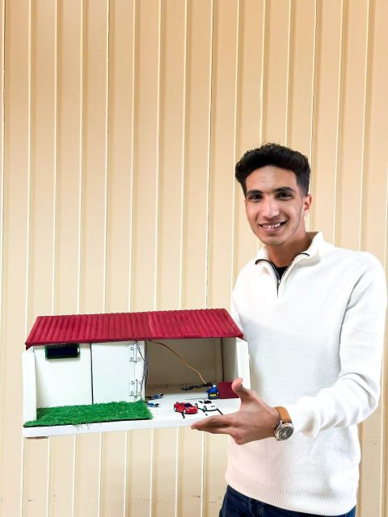

# Hi, I'm Sameh Mosallam

I'm an Electronics and Communications Engineering student at Delta University in Egypt.

I build academic projects in embedded systems, sensors and control systems, and I am developing my skills in telecommunications.

## Skills

- **Programming:** C++
- **Web basics:** HTML, CSS and JavaScript
- **Embedded systems:** Arduino, ESP32 and sensor integration
- **Design and simulation:** Proteus and AutoCAD
- **Development tools:** Arduino IDE and Visual Studio Code

## Projects

### RF Code Cracker
Worked on an academic wireless security simulation using Arduino, ESP32 and 315 MHz RF modules. The team project placed fifth in the faculty projects competition.

### [CNC Machine](https://github.com/samehmosallam/cnc-machine)
Designed and built a Computer Numerical Control machine, applying mechanical design and control-system skills.

### [Smart Air Health Hub](https://github.com/samehmosallam/smart-air-health-hub)
Created an air-quality monitoring project to support environmental health awareness.

### Smart Home with Intelligent Garage
Built an Arduino-based home-automation project with IR, temperature and motion sensors, plus a smart garage module.

## Training

Completed university summer training at Telecom Egypt (WE), East Mansoura Branch, covering transmission networks, SDH, DWDM and fiber-optic systems.

## Find me

[LinkedIn](https://www.linkedin.com/in/samehosama/)
